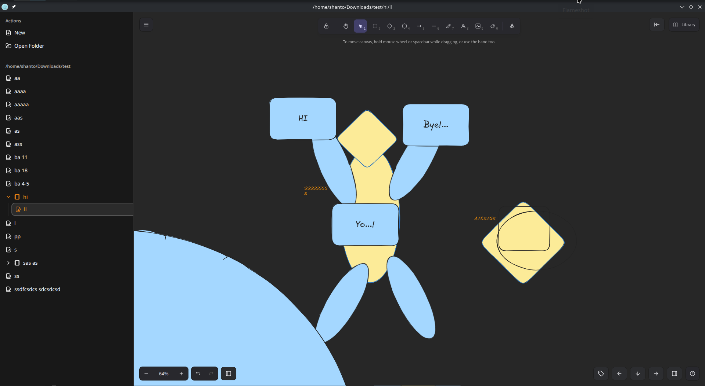

# Vortex



Vortex is my personal Knowledge Management System (KMS), designed to organize ideas, documents, and workflows visually. It is built around **Excalidraw**, giving me a fast, flexible, and intuitive canvas for thought.

## ✨ Features

- 🧩 Visual-first knowledge organization using Excalidraw
- 🗂️ Manage folders, PDFs, and Excalidraw Drawings all in one place
- ⚡ Fast local storage — no cloud required
- 🔍 Easy search and quick navigation using Tags

## 📦 Tech Stack

- **Electron**
- **React**
- **Excalidraw**
- **Node.js / fs**
- **ShadCN UI / Tailwind CSS**

## Structure

This project started as a simple Electron app, with the goal of replacing OneNote using an offline-first approach, similar to apps like Obsidian.

As the project evolved, I reused the renderer (frontend) from the Electron app and turned it into a web application, where an Express server handled the backend logic.

Taking it a step further, I adapted the same renderer again—this time embedding it inside an Android app using WebView. For better performance and native capabilities, I rewrote the backend logic in Kotlin with Gemini, which eventually transformed the project into a fully functional Android application.

## Setup

```bash
# first install yarn and yalc
sudo npm i -g yarn yalc
```

```bash
git clone https://github.com/excalidraw/excalidraw.git

git clone https://github.com/ShantoNoor/vortex.git

yarn --cwd ./vortex/electron-app/ install

# this will run the electron-app
yarn --cwd ./vortex/electron-app/ start
```

## Before runing the Android Project

- Complete the setup then run

```bash
cd vortex/electron-app/
yarn android
```

- This command will create the renderer needed for android project and place it inside the appropriate folder

- Now you can run the Android Project.

## Keyboard Shortcuts
| Shortcut | Action | Condition |
| --- | --- | --- |
| Ctrl + B | Toggle sidebar | Always active |
| Ctrl + U | Toggle right sidebar | Always active |
| , | Select direction: Left | When not typing |
| . | Select direction: Right | When not typing |
| ; | Select direction: Up | When not typing |
| ' | Select direction: Down | When not typing |
| / or Ctrl + W | Select direction: Slide Down | When not typing |
| [ | Lock all elements | When not typing |
| ] | Unlock all elements | When not typing |
| Ctrl + J | Open tag window | When not typing |
| Ctrl + N | Auto set direction: Down | When not typing |
| Ctrl + M | Auto set direction: Right | When not typing |

## Controller & Gamepad Support

The editor includes built-in gamepad support, enabling canvas navigation, tool selection, element alignment, and precise endpoint adjustments using a standard game controller (such as an Xbox or PlayStation controller).

### Button Mappings

| Button | Action |
| :--- | :--- |
| **A** | Auto-align/snap selected element **down** relative to the nearest neighbor |
| **B** | Auto-align/snap selected element **right** relative to the nearest neighbor |
| **X** | Select the **Rectangle** tool |
| **Y** | Select the **Line** tool |
| **Left Bumper (LB)** | Simulated **Left Mouse Click** (Hold to drag/move selected elements) |
| **Right Bumper (RB)** | Simulated **Right Mouse Click** (Context Menu) |
| **Left / Right Trigger (LT / RT)** | Zoom **Out** / Zoom **In** (anchored to the virtual cursor position) |
| **View / Back (Index 8)** | Toggle Sidebar |
| **Menu / Start (Index 9)** | Save current scene |
| **Left Stick Click (L3)** | Undo |
| **Right Stick Click (R3)** | Redo |

### D-Pad Mappings

| D-Pad Direction | Action |
| :--- | :--- |
| **Up** | Toggle Pin (Lock/Unlock all elements except freedraw) |
| **Down** | Slide Down selection direction |
| **Left** | Left selection direction |
| **Right** | Right selection direction |

### Joysticks & Navigation

* **Left Stick:** Pans the canvas viewport. *(Note: If holding **LB** while elements are selected, the left stick moves the selected elements instead of panning).*
* **Right Stick:** Controls the on-screen **virtual mouse cursor** for precise point-and-click interactions.

### Endpoint & Corner Editing Mode

When you select **exactly one** line, arrow, or rectangle, the controller switches to **Endpoint Editing Mode**, repurposing the analog sticks for structural adjustments without dragging handles:

* **Left Stick:** Adjusts the **Start Point** (for lines/arrows) or the **Top-Left Corner** (for rectangles).
* **Right Stick:** Adjusts the **End Point** (for lines/arrows) or the **Bottom-Right Corner** (for rectangles).
* **Any Face Button (A, B, X, Y):** Exits endpoint editing mode and deselects the element.

## Fedora Linux Build Issue Solve:

> https://github.com/electron/forge/issues/3701

### Find RPM Package Name:

```bash
rpm -qa | grep -i "vortex"
```

## Motivation

This project, _Vortex_, began as a personal hobby with the goal of creating an alternative to OneNote. As a long-time OneNote user, I had greatly appreciated its features and usability. However, I recently encountered persistent issues with Microsoft account authentication, which motivated me to build a replacement tailored to my own needs.

Vortex is built upon the foundations of several open-source technologies, and I am deeply grateful to the open-source community for making this project possible. In particular, I would like to extend special thanks to Excalidraw, without which this project would not have existed in its current form. I would also like to thank Gemini, DeepSeek, and ChatGPT for guiding me through every step of the development process.
